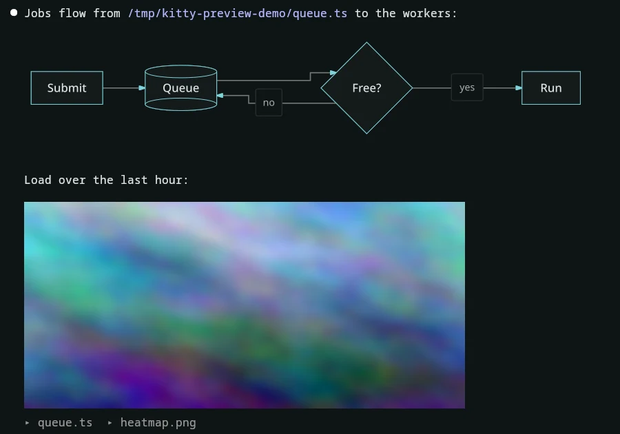
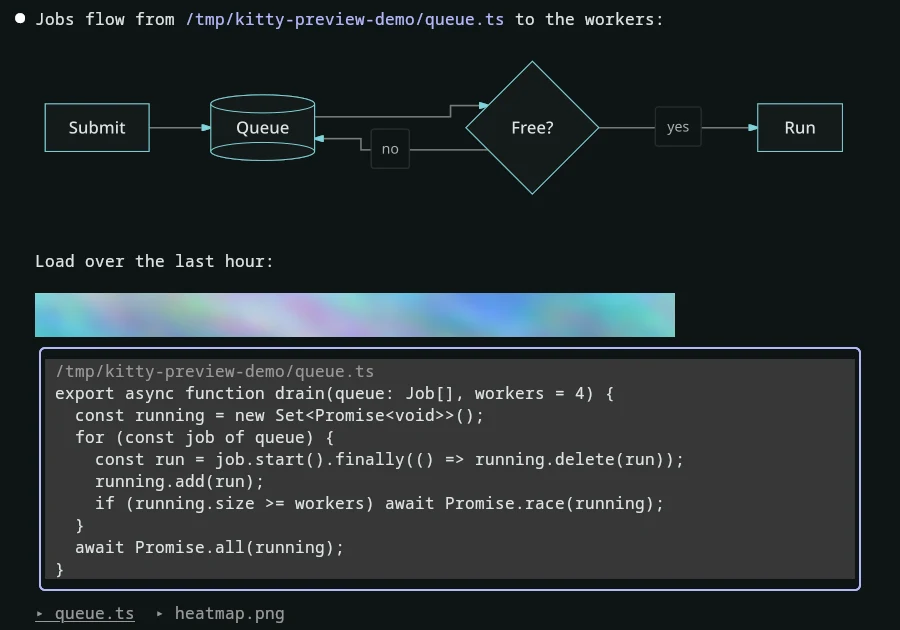

# kitty-preview

**English** | [简体中文](README.zh-CN.md)

[](https://github.com/BANANASJIM/kitty-preview/actions/workflows/ci.yml)
[](LICENSE)

A lightweight [Claude Code](https://code.claude.com) mod for [kitty](https://sw.kovidgoyal.net/kitty/): Mermaid diagrams, images and file previews inside the conversation, through the kitty graphics protocol and without a browser.





## Features

- **Mermaid**: a closed `mermaid` block in a reply becomes a picture, in kitty's own colors. Flowchart, sequence, state, class, ER and xychart; any other kind, and a diagram too large or not fully readable, stays source.
- **Images**: local images in replies (``), images Claude reads, and images pasted into the prompt are drawn inline. PDFs show their first page.
- **Hover previews**: files named in a message, or touched by a Read, Edit or Write call, get a card with the head of the file, the picture, or the directory listing.

## Requirements

- Linux and kitty, not inside tmux
- Claude Code 2.1.331 or later, in the fullscreen layout for hover
- `node`, `rsvg-convert` (librsvg) and `magick` (ImageMagick 7) on `PATH`; `pdftoppm` (poppler) for PDFs

## Install

At the prompt of a Claude Code session:

```
/plugin install kitty-preview --marketplace BANANASJIM/kitty-preview
```

## How it works

`hooks/register.tsx` draws the rows. `bin/render.mjs` makes the PNGs and keeps them in `$XDG_RUNTIME_DIR/claude-kitty-preview`. `bin/probe.py` asks kitty for its colors and cell size. Nothing is sent over the network.

Files a message names are read from disk to draw their cards. What a card shows is not sent to Claude.

## Development

```sh
npm ci --ignore-scripts
npm test                 # renderer, manifest and hooks; needs `claude` on PATH
npm run format           # prettier --check
npm run build            # rebuild bin/vendor, needs bun
claude --plugin-dir .    # a session with the mod loaded
```

Bundled libraries: [THIRD_PARTY_NOTICES.md](THIRD_PARTY_NOTICES.md). License: [MIT](LICENSE).
