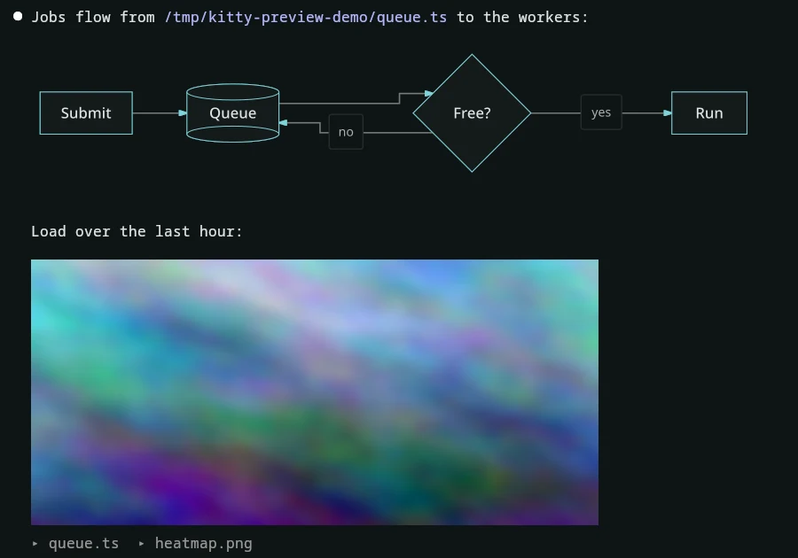
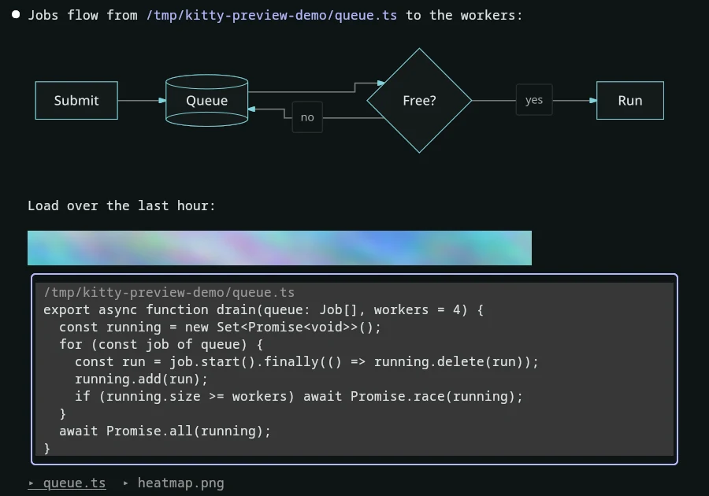

# kitty-preview

[English](README.md) | **简体中文**

[](https://github.com/BANANASJIM/kitty-preview/actions/workflows/ci.yml)
[](LICENSE)

一个轻量的 [Claude Code](https://code.claude.com) mod，给 [kitty](https://sw.kovidgoyal.net/kitty/) 用：在对话里直接显示 Mermaid 图、图片和文件预览。走 kitty graphics protocol，不需要浏览器。





## 功能

- **Mermaid**：回复里写完的 `mermaid` 代码块变成图，颜色跟随 kitty。支持 flowchart、sequence、state、class、ER 和 xychart；其他类型，以及太大或没能完整读懂的图，保留源码。
- **图片**：回复里的本地图片（``）、Claude 读取的图片、粘贴进输入框的图片都内嵌显示。PDF 显示首页。
- **hover 预览**：消息里提到的文件，以及 Read、Edit、Write 碰到的文件，鼠标移上去弹出卡片，显示文件开头、图片或目录列表。

## 依赖

- Linux 和 kitty，不能在 tmux 里
- Claude Code 2.1.331 或更新；hover 需要 fullscreen 布局
- `PATH` 里有 `node`、`rsvg-convert`（librsvg）和 `magick`（ImageMagick 7）；PDF 需要 `pdftoppm`（poppler）

## 安装

在 Claude Code 会话里输入：

```
/plugin install kitty-preview --marketplace BANANASJIM/kitty-preview
```

## 原理

`hooks/register.tsx` 负责画，`renderer/render.mjs` 生成 PNG 并放在 `$XDG_RUNTIME_DIR/claude-kitty-preview`，`renderer/probe.py` 向 kitty 查询颜色和单元格尺寸。不联网。

消息里提到的文件会从磁盘读取来画卡片，卡片内容不会发给 Claude。

## 开发

```sh
npm ci --ignore-scripts
npm test                 # 渲染、manifest 和 hooks；PATH 里要有 claude
npm run format           # prettier --check
npm run build            # 重新构建 renderer/vendor，需要 bun
claude --plugin-dir .    # 加载这个 mod 开一个会话
```

打包的库见 [THIRD_PARTY_NOTICES.md](THIRD_PARTY_NOTICES.md)。协议：[MIT](LICENSE)。
